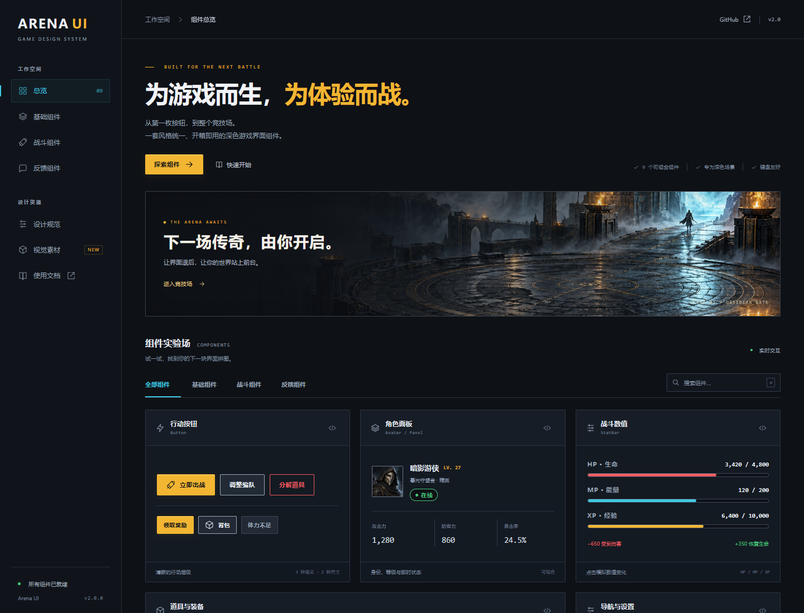
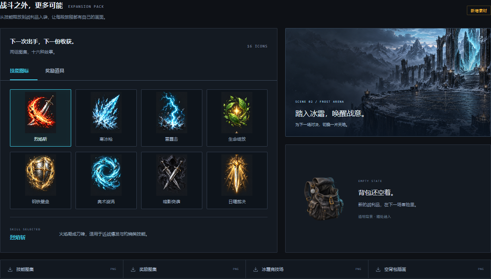

# Arena UI

深色优先的游戏界面设计系统 (dark-first game UI)：金色代表行动与奖励，青色代表选中与能量，红色只代表伤害与危险。

**v2.0** 包含 9 个 React 组件、完整的离线交互演示、8 张 ChatGPT 初始生成原图及其提示词，后续素材通过每日档案持续扩展。三套初始图集共提供 24 个装备、技能与奖励图标。保留起步版组件接口，沿用既有颜色和间距规范。



## 本地预览

需要 Node.js 20 或更新版本：

```sh
npm ci
npm run dev
```

打开 [http://127.0.0.1:4173/demo/](http://127.0.0.1:4173/demo/)。浏览器运行所需的 React、图片和样式均已随仓库保存，预览不依赖 CDN、外部字体或远程图片；也可以用任意静态服务器打开仓库。

演示支持组件分类与搜索、8 件道具筛选和选中、HP 增减、设置开关、弹窗确认，以及用法和颜色复制。演示操作只改变页面状态，不连接游戏服务。

## 每日素材与长期对比

已设置每日北京时间 **09:00** 在原聊天运行：**2 张固定题目 + 2 张轮换扩展素材**。通过本地预览打开 [每日档案](demo/history.html)，可按日期和分类浏览，并将同一固定提示词的历史输出并排查看。

新图片按 `assets/daily/YYYY/MM/DD/<run-id>/` 归档，原图、提示词、校验值与生成记录保留在一起。初次会话已有的八张图片索引为首次手动记录，不代表定时任务已经执行。固定题目使用冻结提示词，不为挑选更好结果而重抽；随机差异与模型升级分开记录。配置见 [assets/daily/config.json](assets/daily/config.json)，执行说明见 [docs/DAILY_GENERATION.md](docs/DAILY_GENERATION.md)。

2026-10-26 另按用户请求追加了 [6 张微信竞技／角色养成透明素材](docs/MINIPROGRAM_ASSETS.md)：奖杯、碎盾、传送门、任务板、锻造台和钥匙。手动追加与定时批次分别记录，原图及用途说明可直接在档案中查看。

同日继续补充了 [4 张透明全身人物立绘](docs/CHARACTER_ASSETS.md)：逐日剑士、霜羽游侠、星辉法师、铁壁守卫，供角色选择、编队和养成页面使用。

已提供 [逐日剑士 8 帧待机预览](demo/sprites.html)，支持播放、逐帧检查、调速和原始／脚底对齐效果比较。[图集、配置与效果说明](docs/SPRITES.md)包含当前样片的漂移和细节变化记录。

定时任务依赖本地电脑开机、桌面应用运行，以及图像工具和账户额度可用；启用计划不等于首个自动批次已验证成功。

## 原则 (Principles)

- **场景在后，信息在前。** 底色压到很暗（`bg-900`、`surface-800`），让角色、特效和数字成为画面主角。
- **颜色有固定含义。** `gold` = 主行动/货币/传说，`cyan` = 选中/焦点/法力，`red` = HP/伤害/危险，`green` = 治疗/增益，`violet` 只用于史诗级稀有度。不要把状态色拿来装饰。
- **硬朗的形状。** 默认 `radius-sm` (2px)，只有浮层用 `radius-md`，进度条和徽章用 `radius-pill`。
- **数字要稳。** 所有会变化的数值用 `stat` 样式（等宽字体），跳数字时宽度不变。

## 颜色 (Color)

只有一套深色主题 (Dark)。层级从深到浅：`bg-900` → `surface-800` → `surface-700`。

| 场景 | 用法 |
| --- | --- |
| 主按钮 | 底 `gold`，文字 `bg-900`（10.4:1） |
| 次按钮 | 底 `surface-700`，边框 `ink-muted`，文字 `ink` |
| 选中 / 焦点 | 2px `cyan` 描边或焦点环 |
| 伤害 / 治疗飘字 | `red` / `green` + `stat` 样式，并带 `-` / `+` 号 |
| 分隔线 | `line`（装饰用，不能当唯一的控件边框） |

对比度备注：`red` 在 `surface-700` 上只有 4.37:1，小字号不要放在这一层；`red` 与 `green` 并用时必须同时用正负号或图标区分（照顾色觉差异）。

## 字体 (Typography)

- `sans`：Inter + 苹方 / 微软雅黑 / Noto Sans SC 回退，覆盖中英文。
- `mono`：JetBrains Mono，用于数值。
- 目前**没有打包字体文件**，依赖用户系统已安装的字体；正式上线前应补上授权字体文件。

样式：`display` 40 · `title` 24 · `heading` 18 · `body` 15 · `caption` 12 · `stat` 20（mono）。

## 间距与圆角 (Spacing & Radius)

4px 基准网格：`space-1` 4 · `space-2` 8 · `space-4` 16 · `space-6` 24。
面板内边距 `space-4`，HUD 距屏幕边缘 `space-6`。

## 组件 (Components)

React 组件，全局命名空间 `window.ArenaUI`，样式在 `components/bundle.css`，类名前缀 `au-`。

| 组件 | 用途 |
| --- | --- |
| `Button` | primary / secondary / danger 三种按钮，`size="sm"` 用于行内 |
| `StatBar` | HP / MP / XP 数值条，HP ≤ 25% 数字变红 |
| `ItemSlot` | 56px 道具格，边框色 = 稀有度（common / rare / epic / legendary） |
| `Badge` | 短状态标签 |
| `Panel` | 标题 + 内容 + 底部操作区的容器 |
| `Tabs` | 受控标签切换，方向键 / Home / End 导航，跳过禁用项 |
| `Toggle` | 受控设置开关，支持鼠标与键盘 |
| `Avatar` | 角色图片，图片加载失败时回退到名字首字 |
| `Dialog` | 原生模态弹窗，支持 Escape、背景关闭、焦点循环与恢复 |

`Button` 另支持 `icon` 和 `loading`。`Panel` 不限制最大宽度，可以透传 `id`、`aria-*` 等 section 属性。详细属性和示例见每个组件目录的 README。

稀有度色阶：common `ink-muted` → rare `cyan` → epic `violet` → legendary `gold`。

## 图标 (Iconography)

品牌使用纯文字名称。预览中的线性功能图标为代码绘制的 SVG；游戏道具和头像使用生成图片，不把它们混作功能图标。

## 视觉素材

素材通过用户澄清的 **ChatGPT 内置图像生成功能**制作，不需要本地 API 密钥。工具没有返回底层模型版本，因此不把它标记为已核实的 Image 2.5。

| 素材 | 文件 |
| --- | --- |
| 黑曜石之门场景 | [campaign-wide.png](assets/generated/campaign-wide.png) |
| 8 件装备图集（4 列 × 2 行） | [equipment-atlas.png](assets/generated/equipment-atlas.png) |
| 暗影游侠头像 | [sentinel-portrait.png](assets/generated/sentinel-portrait.png) |
| 组件视觉参考板 | [ui-kit-board.png](assets/generated/ui-kit-board.png) |
| 8 个战斗技能图标（4 列 × 2 行） | [skills-atlas.png](assets/generated/skills-atlas.png) |
| 8 个奖励与货币图标（4 列 × 2 行） | [rewards-atlas.png](assets/generated/rewards-atlas.png) |
| 冰霜竞技场场景 | [frost-arena.png](assets/generated/frost-arena.png) |
| 透明空背包插画 | [empty-inventory.png](assets/generated/empty-inventory.png) |



原始提示词见 [assets/prompts.json](assets/prompts.json)，实际尺寸与文件校验见 [assets/manifest.json](assets/manifest.json)，复用说明见 [docs/ASSETS.md](docs/ASSETS.md)。参考板是视觉探索，交互、颜色语义和组件属性以代码与 token 为准。

## 文案 (Voice)

短、直接、动词开头：「出战」「领取」「强化」。数值写清楚单位和回合：「冷却 3 回合」「+15% 暴击率」。

## 目录结构 (Repository layout)

```
tokens/tokens.json      所有 token 的源数据（颜色、字体、间距、圆角）
tokens/tokens.css       由 tokens.json 生成的 CSS 变量和文字样式类
components/bundle.js    组件脚本，挂到 window.ArenaUI（依赖 React 18）
components/bundle.css   组件样式（类名前缀 au-）
components/index.d.ts   组件类型定义（文档用）
components/<组件>/README.md  每个组件的使用规范
demo/index.html         所有颜色和组件的演示页
demo/app.js             交互演示（无编译步骤）
demo/demo.css           响应式展示页样式
demo/vendor/            React 18.3.1 本地脚本及其 MIT 授权
assets/generated/      八张生成原图（含三套图集和透明插画）
assets/prompts.json     实际使用的完整提示词
assets/manifest.json    素材来源、尺寸、校验值
docs/ASSETS.md          图集排列与复用说明
scripts/                本地预览服务与依赖复制工具
tests/                  Playwright 浏览器验证
```

## 使用方法 (Usage)

```html
<link rel="stylesheet" href="tokens/tokens.css">
<link rel="stylesheet" href="components/bundle.css">
<script src="demo/vendor/react.production.min.js"></script>
<script src="demo/vendor/react-dom.production.min.js"></script>
<script src="components/bundle.js"></script>
<div id="app"></div>
<script>
  // 渲染一个主按钮
  const { Button } = window.ArenaUI;
  ReactDOM.createRoot(document.getElementById('app')).render(React.createElement(Button, null, '出战'));
</script>
```

只想用颜色和字体时，引入 `tokens/tokens.css` 后直接写 `var(--gold)`、`class="stat"` 即可。

演示页：开启 GitHub Pages（Settings → Pages → 从 main 分支根目录部署）后访问 `/demo/`。

## 验证

```sh
npm run test:install
npm test
```

测试覆盖离线资源加载、手机布局、道具筛选、组件搜索、弹窗焦点与键盘交互。Windows 若已安装 Chrome 或 Edge，测试配置会自动使用本地浏览器，可省略浏览器安装步骤。`npm run vendor` 可从锁定依赖重新复制 React 脚本和授权文件。

这是浏览器全局组件包，通过 `window.ArenaUI` 消费；尚未发布 npm 包或提供 ESM 构建。字体继续使用系统回退，不包含商业字体文件。
